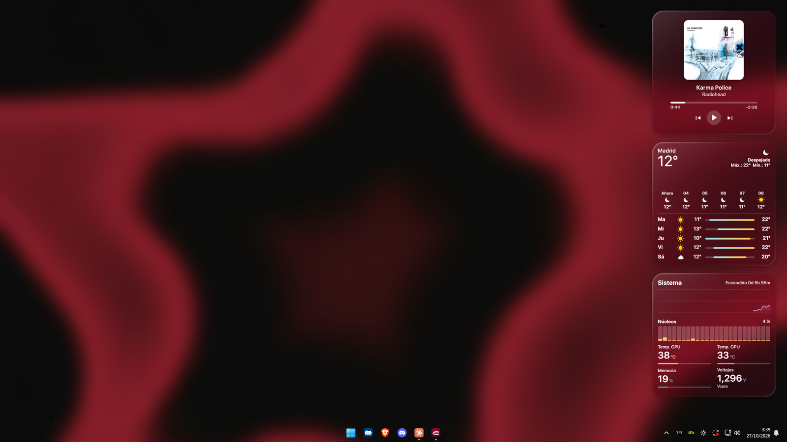
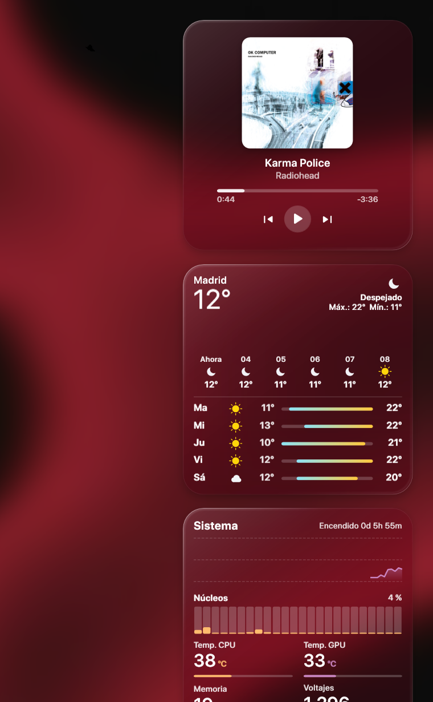
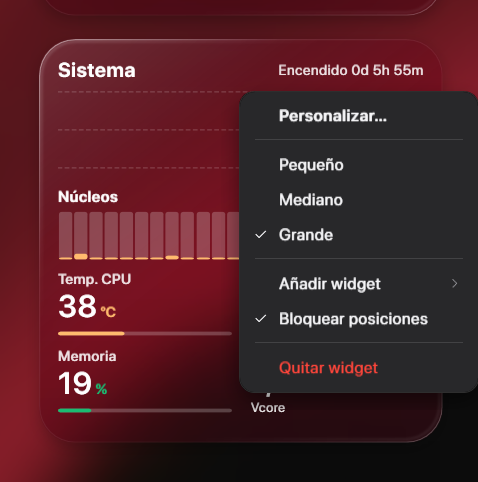
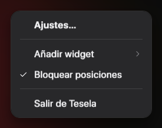
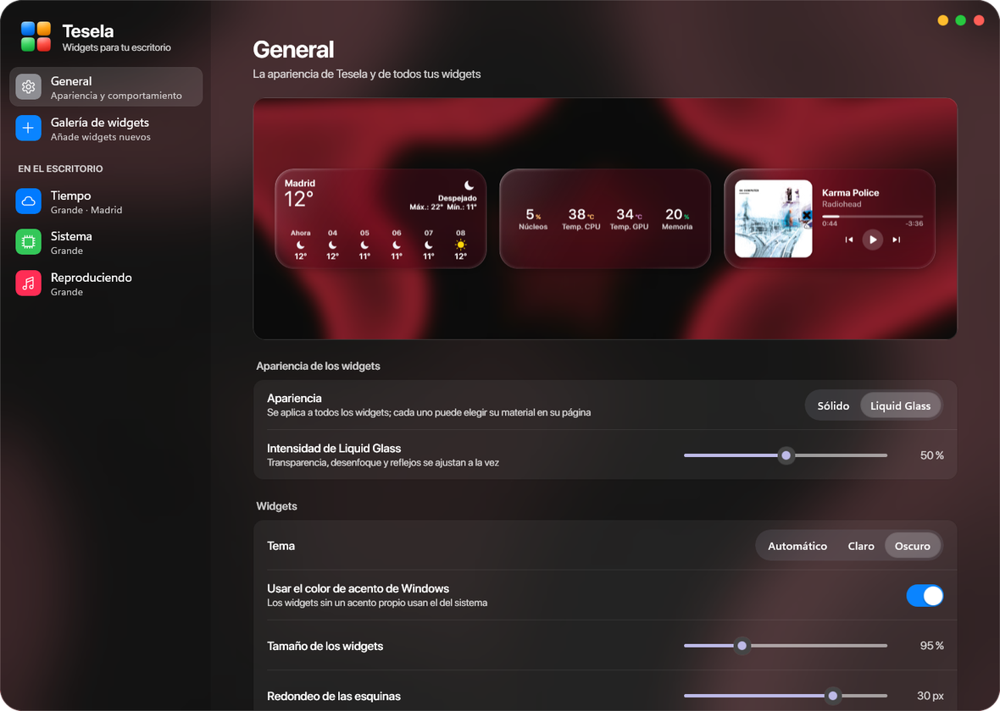
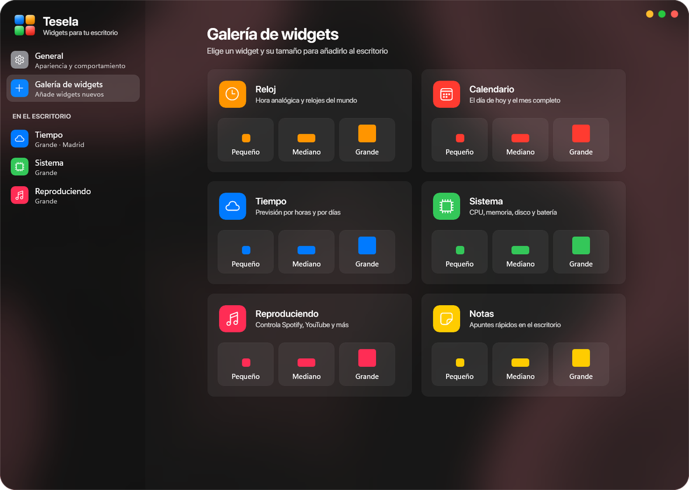
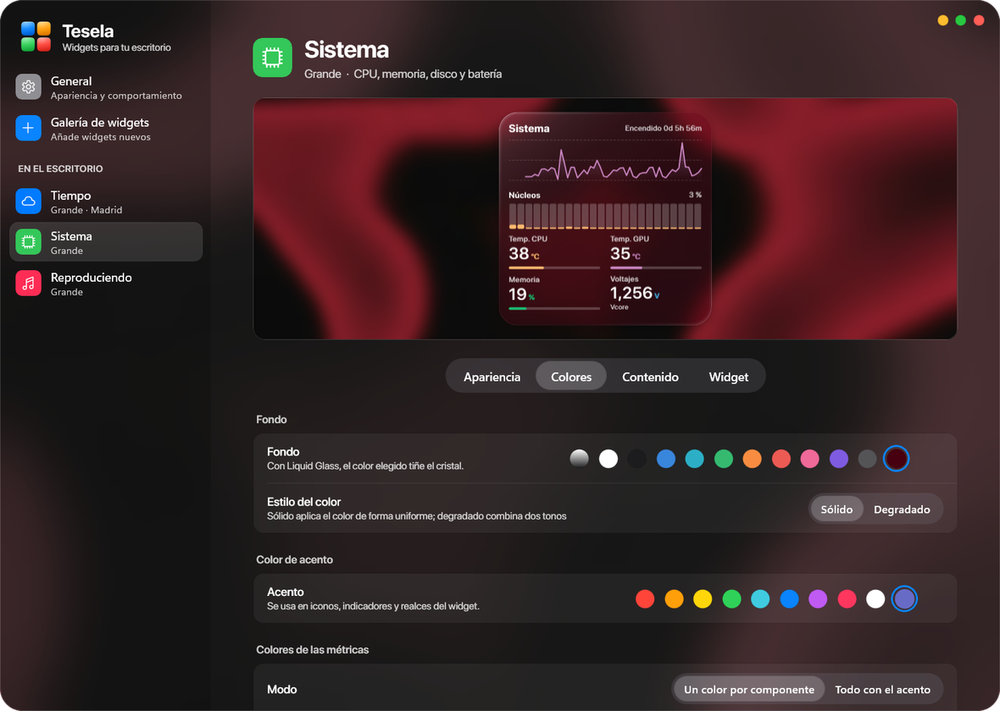
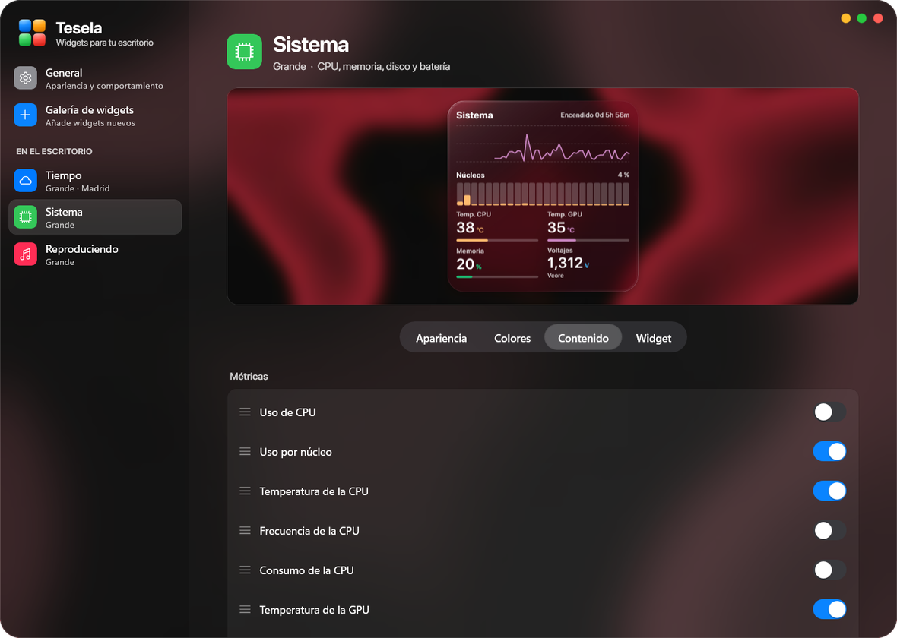
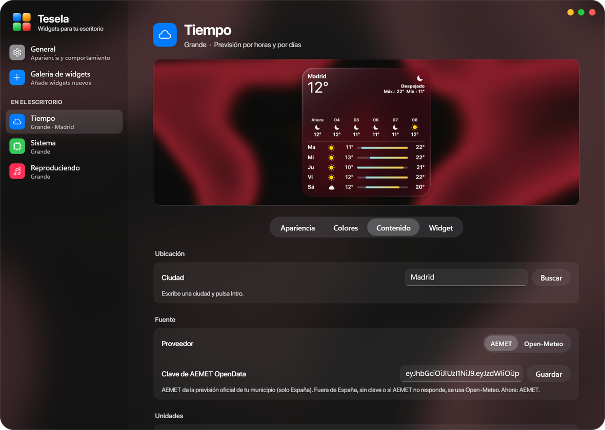
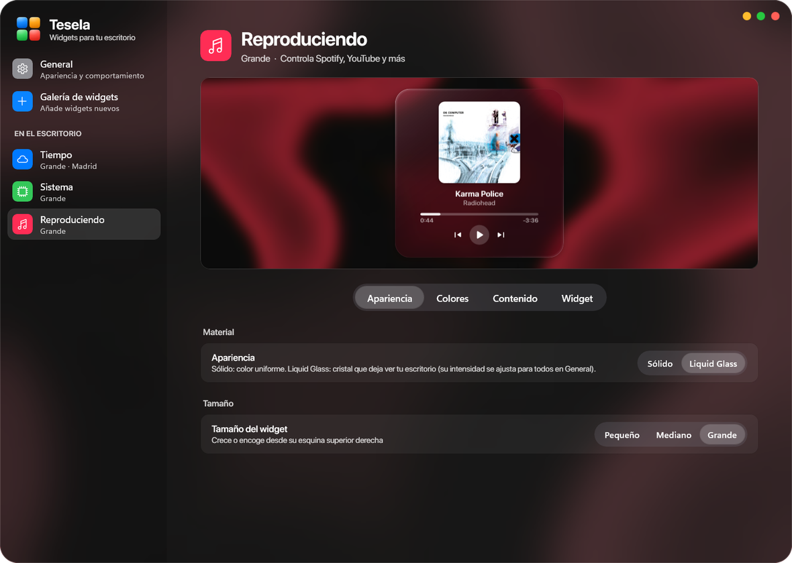

<p align="center">
  
</p>

<h1 align="center">Tesela</h1>

<p align="center">
  Widgets de escritorio al estilo de iOS y macOS para Windows 10 y 11.<br>
  <a href="README.md">English</a> · <b>Español</b>
</p>

<p align="center">
  
</p>

Tesela pone en tu escritorio widgets pequeños, medianos y grandes que encajan en una cuadrícula, como las
teselas de un mosaico. Viven sobre el fondo de pantalla, por debajo de tus ventanas, y pueden ser sólidos o
de **Liquid Glass**: un cristal que desenfoca el fondo que hay detrás de cada widget y lo sigue en tiempo
real.

## Widgets

| | |
|---|---|
|  | **Reloj** — reloj analógico con segundero opcional y hasta cuatro relojes del mundo.<br><br>**Calendario** — el día de hoy y el mes completo.<br><br>**Tiempo** — tiempo actual, previsión por horas y próximos días. En España usa la previsión oficial de AEMET (con tu clave gratuita) y en el resto del mundo, Open‑Meteo.<br><br>**Sistema** — CPU, uso por núcleo, GPU, memoria, discos, red, batería y sensores (temperaturas de CPU y placa, ventiladores y voltajes). En números, barras, anillos o gráficas, con un color por componente.<br><br>**Reproduciendo** — controla Spotify, YouTube, Apple Music y cualquier app que aparezca en los controles multimedia de Windows, con los colores de la carátula, una animación de baraja entre canciones y búsqueda de carátula cuando la app no da una buena.<br><br>**Notas** — apuntes rápidos en el escritorio. |

Cada widget tiene tres tamaños (pequeño 1×1, mediano 2×1 y grande 2×2), se puede arrastrar a cualquier
sitio y encaja en el hueco libre más cercano.

## Menús

<p>
  
  &nbsp;
  
</p>

Con clic derecho en un widget puedes personalizarlo, cambiar su tamaño, añadir otro, bloquear las
posiciones o quitarlo. El icono de la bandeja abre los ajustes y permite añadir widgets o salir.

## Ajustes

<p align="center">
  
</p>

<details>
<summary><b>Más capturas</b></summary>

<p align="center">
  <br><br>
  <br><br>
  <br><br>
  <br><br>
  
</p>
</details>

- **General:** material Sólido o Liquid Glass e intensidad del cristal, tema, color de acento de Windows,
  tamaño de los widgets, redondeo, opacidad, sombra, tipografía (Figtree, o SF Pro Display si está
  instalada), idioma (español o inglés), bloquear posiciones, iniciar con Windows y reorganizar.
- **Galería:** añade cualquier widget en cualquier tamaño.
- **Cada widget:** vista previa en vivo sobre tu propio fondo de pantalla y las pestañas Apariencia, Colores,
  Contenido y Widget.

## Instalación

1. Descarga `tesela-setup-v1.0.exe` desde [Releases](https://github.com/IvannPerezz/Tesela/releases).
2. Ejecútalo y sigue los pasos. Puedes crear un acceso directo en el escritorio y abrir Tesela al terminar.

Tesela se abre en la bandeja del sistema. Haz doble clic en su icono para abrir los ajustes.

**Requisitos:** Windows 10 (1809 o posterior) o Windows 11 de 64 bits. Todo lo que necesita va incluido en
el instalador.

### Sensores de hardware

El uso de CPU, la GPU (NVIDIA), la memoria, los discos y la red funcionan sin configurar nada. Las
temperaturas de CPU y placa, los ventiladores y los voltajes necesitan acceso de administrador al
hardware: en el widget de Sistema ve a **Contenido → Sensores → Activar**. Windows pide permiso una sola
vez y Tesela crea la tarea programada `Tesela\Sensores` para no volver a preguntar. Leer el chip de la placa
base necesita además el controlador [PawnIO](https://pawnio.eu), que instala
[LibreHardwareMonitor](https://github.com/LibreHardwareMonitor/LibreHardwareMonitor).

### Tiempo

Fuera de España, el widget del Tiempo usa [Open‑Meteo](https://open-meteo.com) sin configurar nada. En
España puedes usar la previsión oficial de AEMET: pide una clave gratuita en
[AEMET OpenData](https://opendata.aemet.es/centrodedescargas/altaUsuario) y pégala en
**Tiempo → Contenido → Fuente**.

## Compilar desde el código

```powershell
.\build.ps1
```

- **Tesela** (`src\`, WPF sobre .NET Framework 4.8) se compila con el compilador Roslyn de Visual Studio
  Build Tools.
- **La ventana de ajustes** (`settings\`, WinUI 3 sobre .NET 8 con Windows App SDK) se compila con el SDK
  de .NET 8.
- `installer\build-installer.ps1` genera `tesela-setup-v1.0.exe` con [Inno Setup 6](https://jrsoftware.org/isinfo.php).

Tesela debe estar cerrado al compilar. Opciones útiles para probar:

- `Tesela.exe --settings [general|gallery|<id del widget>]` abre los ajustes en esa página.
- `Tesela.exe --preview salida.png [dark] [glass] [level=0..1] [wall=imagen] [lang=en]` dibuja todos los
  widgets en todos los tamaños.
- `--test-resize`, `--test-deck`, `--test-menu` y `--test-art "título" "artista"` prueban el redimensionado,
  el cambio de canción, el menú de la bandeja y la búsqueda de carátulas sin tocar tu música.

La configuración se guarda en `%APPDATA%\Tesela\state.json`.

## Licencias

Tesela usa estos componentes de terceros. Los detalles están en
[THIRD-PARTY-NOTICES.md](THIRD-PARTY-NOTICES.md).

| Componente | Licencia |
|---|---|
| Tipografía [Figtree](https://github.com/erikdkennedy/figtree) | SIL Open Font License 1.1 |
| [LibreHardwareMonitorLib](https://github.com/LibreHardwareMonitor/LibreHardwareMonitor) | Mozilla Public License 2.0 |
| [HidSharp](https://www.zer7.com/software/hidsharp) | Apache License 2.0 |
| DiskInfoToolkit, RAMSPDToolkit, BlackSharp.Core (dependencias de LibreHardwareMonitor) | Mozilla Public License 2.0 |
| [Windows App SDK](https://github.com/microsoft/WindowsAppSDK) y WinUI 3 | MIT |
| Runtime de [.NET](https://github.com/dotnet/runtime) y librerías System.* | MIT |

Datos: tiempo de [Open‑Meteo](https://open-meteo.com) (CC BY 4.0) y [AEMET](https://www.aemet.es) (© AEMET);
búsqueda de carátulas con la iTunes Search API.

SF Pro y los iconos de Apple **no** se incluyen: Tesela solo usa SF Pro si la has instalado tú.

El diseño de la ventana de ajustes está inspirado en
[TranslucentTB Revamped](https://github.com/IvannPerezz/TranslucentTB-Revamped).
