[README.md](https://github.com/user-attachments/files/33995580/README.md)
<p align="center">
  
</p>

<h1 align="center">Tesela</h1>

<p align="center">
  iOS‑ and macOS‑style desktop widgets for Windows 10 and 11.<br>
  <b>English</b> · <a href="README.es.md">Español</a>
</p>

<p align="center">
  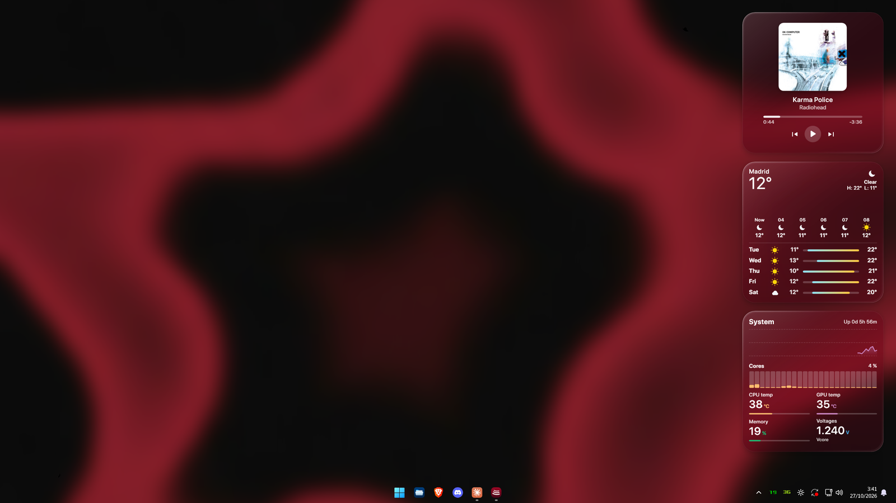
</p>

Tesela puts small, medium and large widgets on your desktop that snap to a grid like the tiles of a
mosaic (that's what *tesela* means in Spanish). They sit on the wallpaper, below your windows, and can be
solid or **Liquid Glass**: a glass material that blurs the wallpaper behind each widget and follows it in
real time.

## Widgets

| | |
|---|---|
| 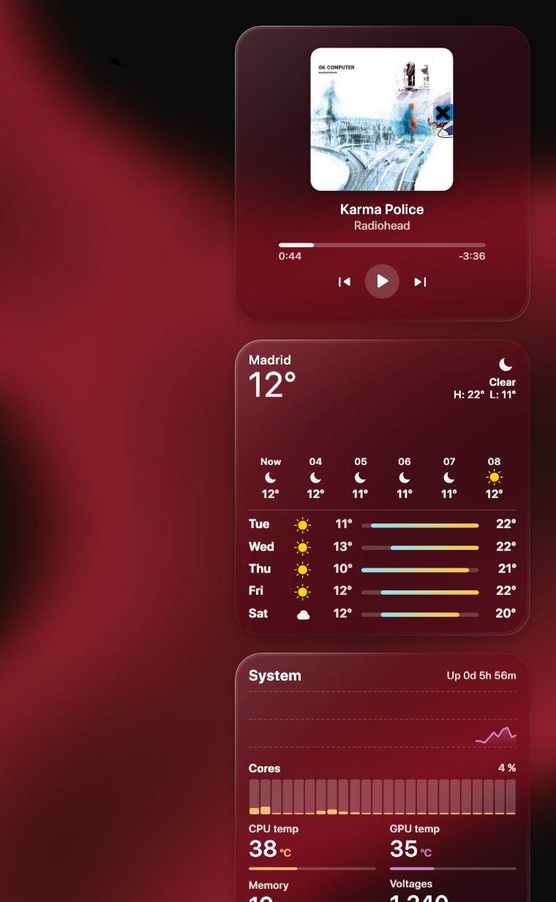 | **Clock** — analog clock with an optional second hand and up to four world clocks.<br><br>**Calendar** — today's date and the whole month.<br><br>**Weather** — current conditions, hourly forecast and the next days. Uses the official forecast from AEMET in Spain (with your free API key) and Open‑Meteo everywhere else.<br><br>**System** — CPU, per‑core usage, GPU, memory, drives, network, battery and hardware sensors (CPU and board temperatures, fans, voltages). Numbers, bars, rings or charts, with one color per component.<br><br>**Now Playing** — controls Spotify, YouTube, Apple Music and any app that shows up in Windows' media controls, with the artwork's colors, a card‑shuffle animation between songs and artwork lookup when the app doesn't provide a good one.<br><br>**Notes** — quick notes right on the desktop. |

Every widget comes in three sizes (small 1×1, medium 2×1 and large 2×2), can be dragged anywhere and
snaps to the nearest free spot.

## Menus

<p>
  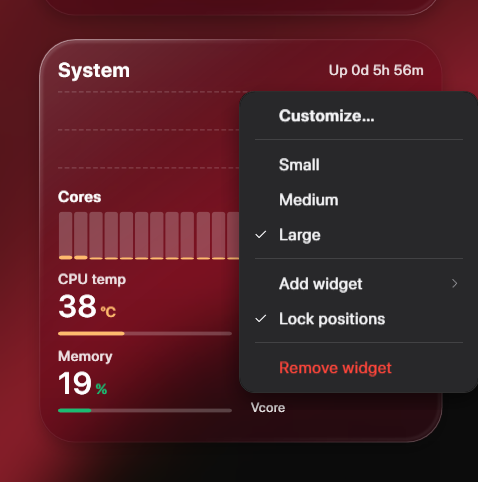
  &nbsp;
  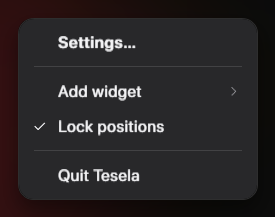
</p>

Right‑click a widget to customize it, change its size, add another one, lock positions or remove it.
The tray icon opens the settings and lets you add widgets or quit.

## Settings

<p align="center">
  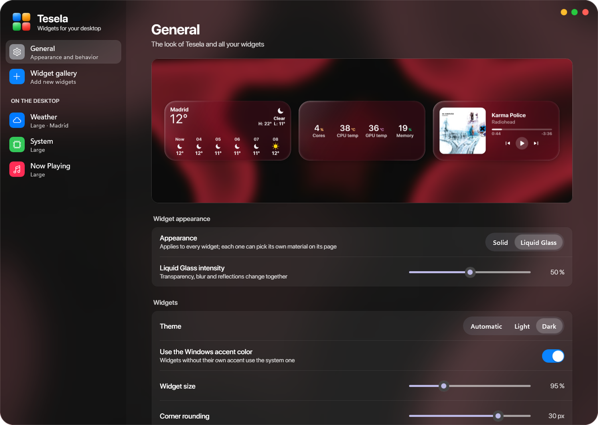
</p>

<details>
<summary><b>More screenshots</b></summary>

<p align="center">
  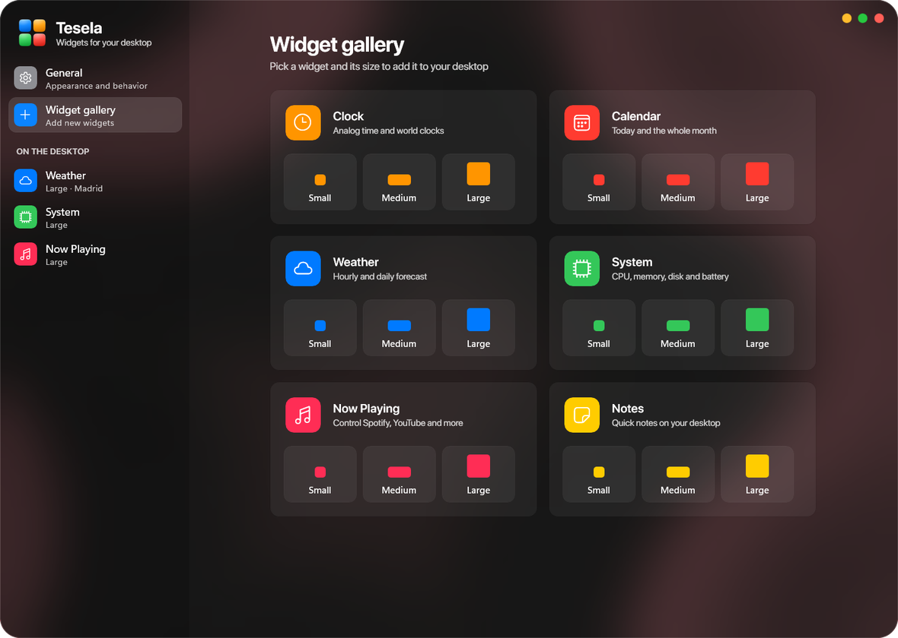<br><br>
  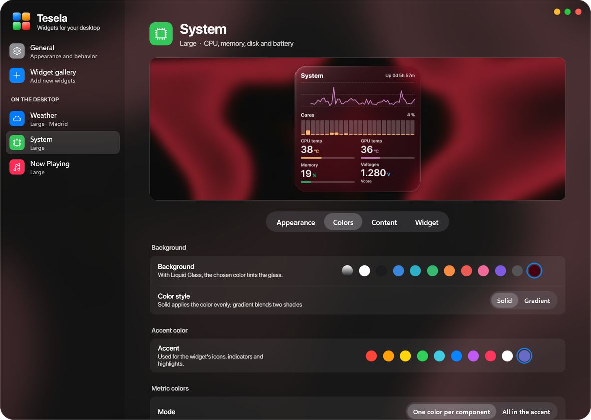<br><br>
  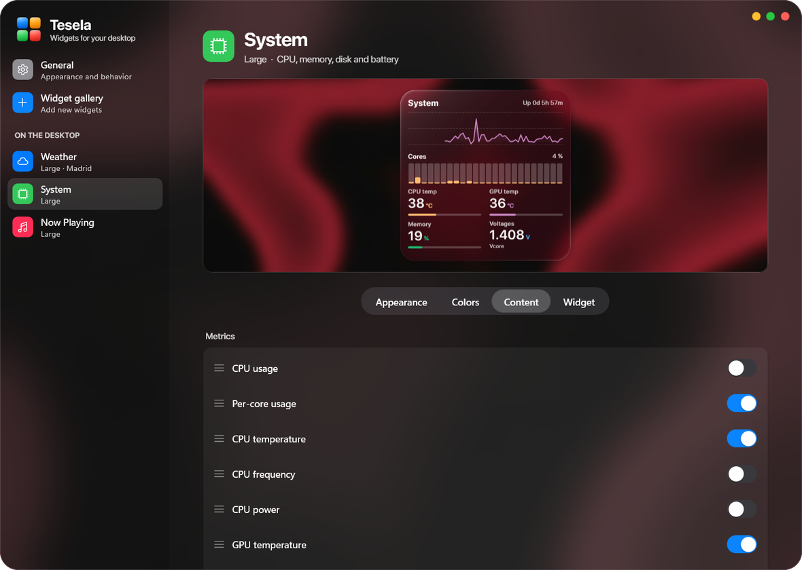<br><br>
  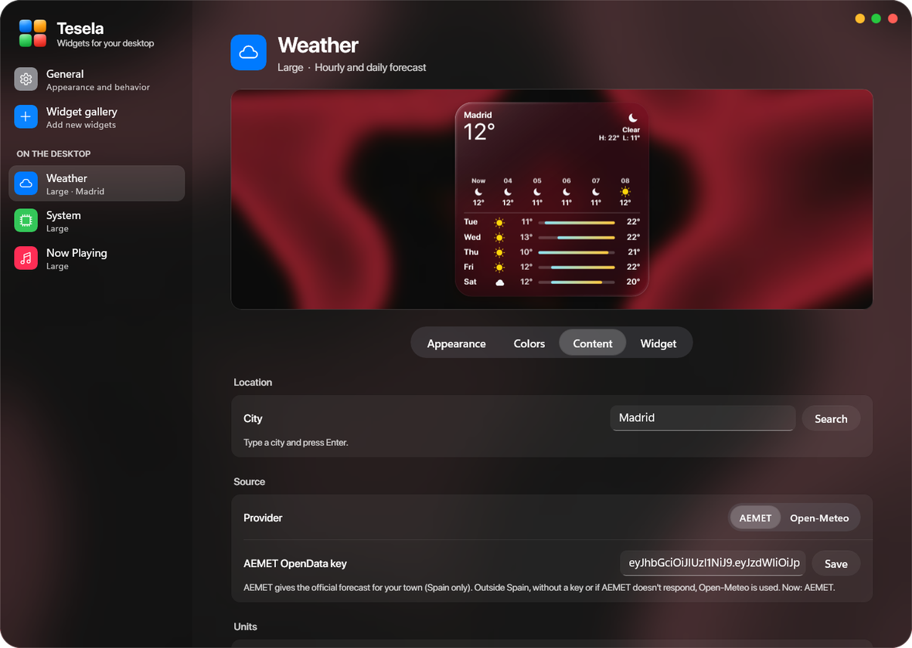<br><br>
  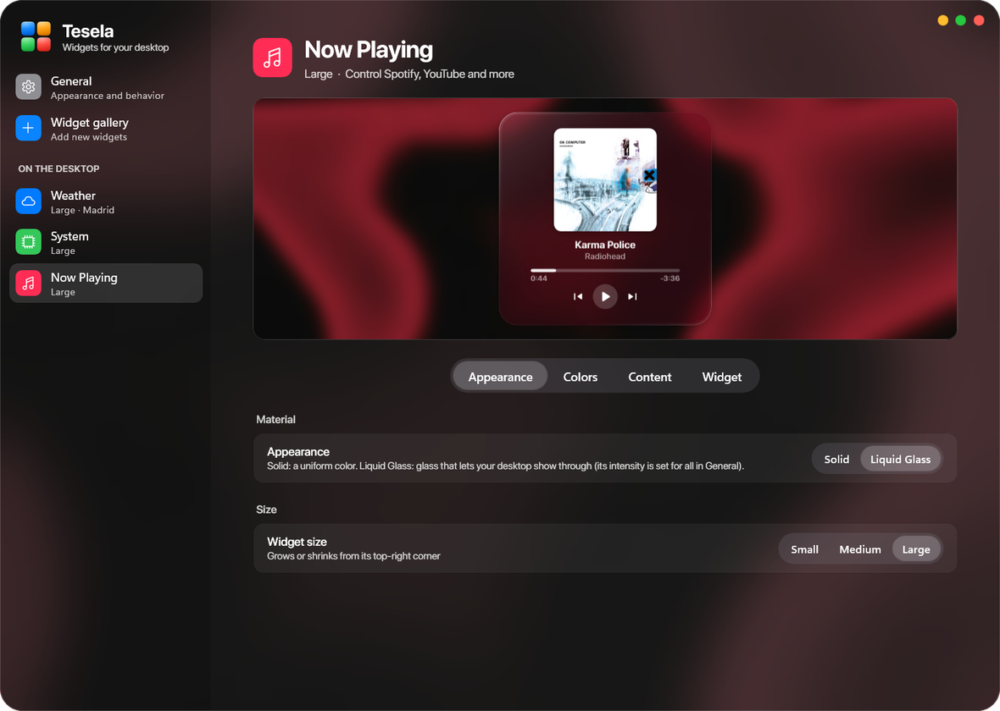
</p>
</details>

- **General:** Solid or Liquid Glass material and glass intensity, theme, Windows accent color, widget
  size, corner rounding, opacity, shadow, font (Figtree, or SF Pro Display if it's installed), language
  (English or Spanish), lock positions, start with Windows and rearrange.
- **Gallery:** add any widget in any size.
- **Each widget:** live preview on your own wallpaper and the Appearance, Colors, Content and Widget tabs.

## Installation

1. Download `tesela-setup-v1.0.exe` from [Releases](https://github.com/IvannPerezz/Tesela/releases).
2. Run it and follow the steps. You can create a desktop shortcut and start Tesela right away.

Tesela starts in the tray. Double‑click the tray icon to open the settings.

**Requirements:** Windows 10 (1809 or later) or Windows 11, 64‑bit. Everything it needs comes with the
installer.

### Hardware sensors

CPU usage, GPU (NVIDIA), memory, drives and network work out of the box. CPU and motherboard
temperatures, fans and voltages need administrator access to the hardware: in the System widget, go to
**Content → Sensors → Turn on**. Windows asks for permission once and Tesela creates the
`Tesela\Sensores` scheduled task so it never has to ask again. Reading the motherboard chip also needs
the [PawnIO](https://pawnio.eu) driver, which [LibreHardwareMonitor](https://github.com/LibreHardwareMonitor/LibreHardwareMonitor)
installs.

### Weather

Outside Spain the Weather widget uses [Open‑Meteo](https://open-meteo.com) with no setup. In Spain you can
use the official AEMET forecast: request a free key at
[AEMET OpenData](https://opendata.aemet.es/centrodedescargas/altaUsuario) and paste it in
**Weather → Content → Source**.

## Building from source

```powershell
.\build.ps1
```

- **Tesela** (`src\`, WPF on .NET Framework 4.8) is built with the Roslyn compiler from Visual Studio
  Build Tools.
- **The settings window** (`settings\`, WinUI 3 on .NET 8 with the Windows App SDK) is built with the
  .NET 8 SDK.
- `installer\build-installer.ps1` builds `tesela-setup-v1.0.exe` with [Inno Setup 6](https://jrsoftware.org/isinfo.php).

Tesela must be closed while building. Handy options for testing:

- `Tesela.exe --settings [general|gallery|<widget id>]` opens the settings on that page.
- `Tesela.exe --preview out.png [dark] [glass] [level=0..1] [wall=image] [lang=en]` renders every widget in
  every size.
- `--test-resize`, `--test-deck`, `--test-menu` and `--test-art "title" "artist"` exercise resizing, the
  song change, the tray menu and artwork lookup without touching your music.

Settings are stored in `%APPDATA%\Tesela\state.json`.

## Licenses

Tesela uses these third‑party components. See [THIRD-PARTY-NOTICES.md](THIRD-PARTY-NOTICES.md) for the
details.

| Component | License |
|---|---|
| [Figtree](https://github.com/erikdkennedy/figtree) font | SIL Open Font License 1.1 |
| [LibreHardwareMonitorLib](https://github.com/LibreHardwareMonitor/LibreHardwareMonitor) | Mozilla Public License 2.0 |
| [HidSharp](https://www.zer7.com/software/hidsharp) | Apache License 2.0 |
| DiskInfoToolkit, RAMSPDToolkit, BlackSharp.Core (LibreHardwareMonitor dependencies) | Mozilla Public License 2.0 |
| [Windows App SDK](https://github.com/microsoft/WindowsAppSDK) and WinUI 3 | MIT |
| [.NET](https://github.com/dotnet/runtime) runtime and System.* libraries | MIT |

Data: weather by [Open‑Meteo](https://open-meteo.com) (CC BY 4.0) and
[AEMET](https://www.aemet.es) (© AEMET); artwork lookup through the iTunes Search API.

SF Pro and Apple's icons are **not** included: Tesela only uses SF Pro if you've installed it yourself.

The design of the settings window is inspired by
[TranslucentTB Revamped](https://github.com/IvannPerezz/TranslucentTB-Revamped).
